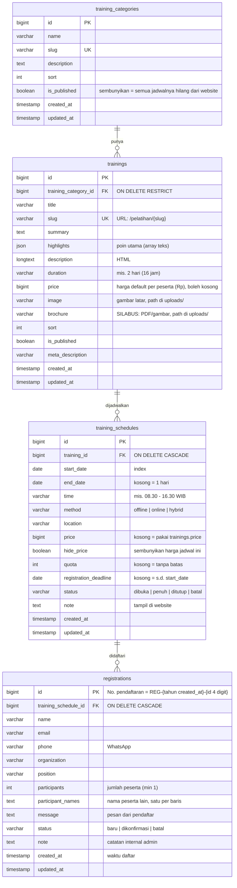
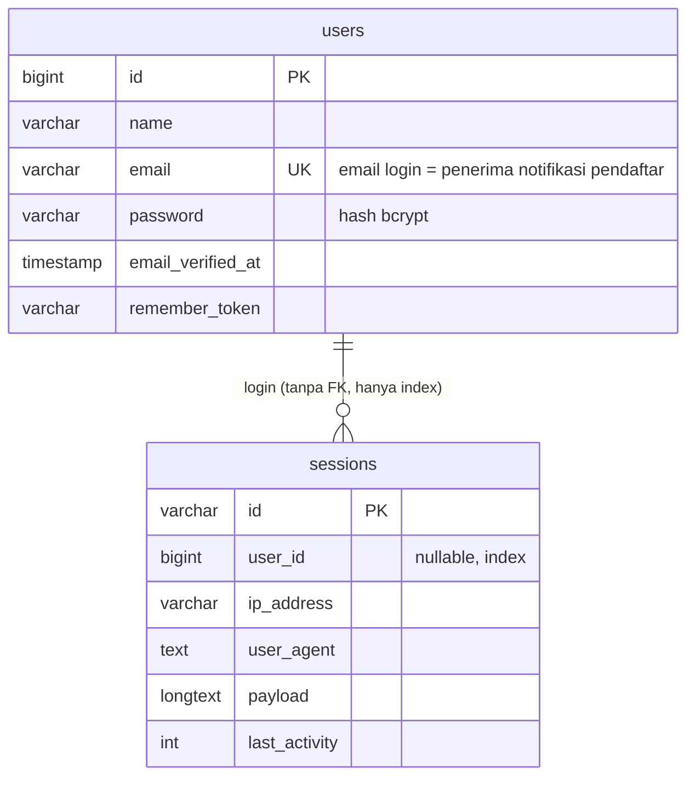
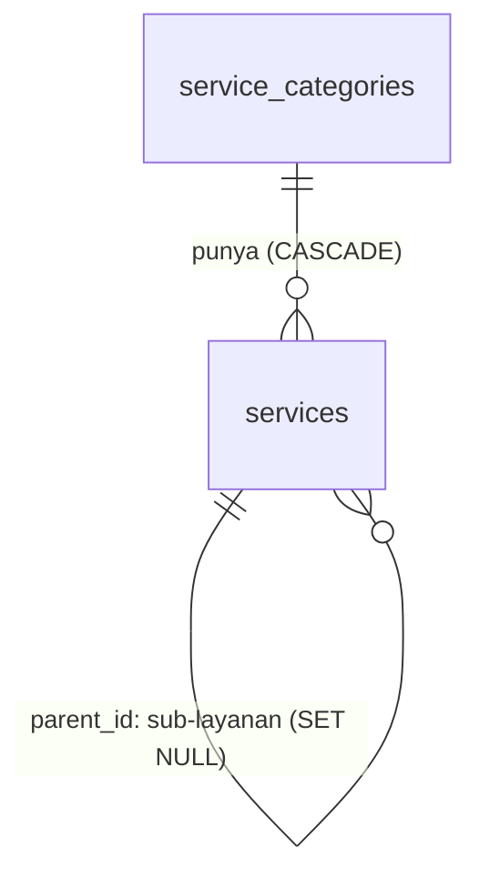

# Struktur Database CMS INOVASS

Diturunkan dari `database/migrations/` (kondisi 23 Okt 2026). Server: **MySQL** `inom3994_inovass`; laptop: SQLite. Diagram di bawah tampil sebagai gambar di GitHub (Mermaid).

## Kelompok tabel

| Kelompok | Tabel | Dipakai? |
|---|---|---|
| **Inti pelatihan** | `training_categories`, `trainings`, `training_schedules`, `registrations` | Ya: website + admin |
| **Pengaturan** | `page_contents` (key `settings`: WhatsApp, kontak, saklar harga) | Ya |
| **Akun & sistem** | `users`, `sessions`, `password_reset_tokens`, `cache`, `cache_locks`, `jobs`, `job_batches`, `failed_jobs` | Ya (bawaan Laravel) |
| **Konten compro lama** | `service_categories`, `services`, `products`, `clients`, `testimonials`, `faqs`, `articles`, `contact_messages` | Data ada, **tidak dikelola di admin** (situs compro = HTML statis) |

## 1. Diagram inti (pelatihan & pendaftaran)



### Relasi & efek hapus

| Relasi | Kardinalitas | Bila induk dihapus |
|---|---|---|
| `training_categories` → `trainings` | 1 : N | **Ditolak** (RESTRICT): kategori yang masih punya program tidak bisa dihapus |
| `trainings` → `training_schedules` | 1 : N | **Ikut terhapus** (CASCADE) |
| `training_schedules` → `registrations` | 1 : N | **Ikut terhapus** (CASCADE). ⚠ Menghapus jadwal = menghapus data pendaftarnya. Lebih aman ubah status jadwal ke `batal` |

Tidak ada relasi antara `users` (admin) dan `registrations`: semua admin melihat & menerima email semua pendaftar.

## 2. Nilai turunan (tidak disimpan sebagai kolom)

Dihitung di model (`app/Models/TrainingSchedule.php`, `Registration.php`) setiap kali dibutuhkan:

| Nilai | Rumus |
|---|---|
| **Harga efektif** jadwal | `training_schedules.price`, bila kosong `trainings.price` |
| **Harga tampil di website** | `page_contents[settings].show_prices = true` **dan** `hide_price = false` **dan** harga efektif ada. Selain itu tampil "Hubungi kami" |
| **Kursi terisi** | `SUM(registrations.participants)` untuk jadwal itu, **kecuali** `status = 'batal'` |
| **Sisa kursi** | `quota - kursi terisi` (kosong bila `quota` kosong) |
| **Bisa daftar** | `status = 'dibuka'` **dan** hari ini ≤ `registration_deadline` (atau `start_date`) **dan** sisa kursi > 0 / tanpa kuota |
| **Status publik** | `status` ≠ dibuka → label status; sisa kursi 0 → "Penuh"; lewat batas → "Pendaftaran ditutup"; selain itu "Dibuka" |
| **Jadwal tampil di website** | `status ≠ 'batal'` **dan** `COALESCE(end_date, start_date) ≥ hari ini` **dan** program & kategorinya `is_published = true` |
| **No. pendaftaran** | `REG-` + tahun `created_at` + `-` + `id` 4 digit, mis. `REG-2026-0042` |
| **Perkiraan biaya** pendaftar | harga efektif × `participants` (untuk admin; tetap dihitung walau harga disembunyikan) |

## 3. Pengaturan (`page_contents`)

| Kolom | Isi |
|---|---|
| `key` (unik) | `settings` (dipakai), `home`/`tentang`/`produk`/`kontak` (konten compro lama) |
| `data` (JSON) | untuk `settings`: `site_name`, `tagline`, `description`, `logo`, `phone`, `whatsapp`, `email`, `address`, `socials[]`, `copyright`, **`show_prices`** |

## 4. Akun & sistem (bawaan Laravel)



`cache`, `cache_locks`, `jobs`, `job_batches`, `failed_jobs`, `password_reset_tokens`: tabel teknis, tidak perlu dianalisis.

## 5. Konten compro lama (tidak dipakai admin)



`products`, `clients`, `testimonials`, `faqs`, `articles`, `contact_messages` berdiri sendiri (tanpa relasi). Diisi seeder dari situs lama; boleh diabaikan untuk analisis pelatihan.

## 6. Contoh query analisis (MySQL, phpMyAdmin → tab SQL)

Pendaftar & peserta per program per bulan (tanpa yang batal):

```sql
SELECT t.title AS program,
       DATE_FORMAT(r.created_at, '%Y-%m') AS bulan,
       COUNT(*) AS pendaftar,
       SUM(r.participants) AS peserta
FROM registrations r
JOIN training_schedules s ON s.id = r.training_schedule_id
JOIN trainings t ON t.id = s.training_id
WHERE r.status <> 'batal'
GROUP BY t.title, bulan
ORDER BY bulan DESC, peserta DESC;
```

Keterisian kuota per jadwal:

```sql
SELECT t.title, s.start_date, s.location, s.quota,
       COALESCE(SUM(CASE WHEN r.status <> 'batal' THEN r.participants END), 0) AS terisi,
       ROUND(100 * COALESCE(SUM(CASE WHEN r.status <> 'batal' THEN r.participants END), 0) / NULLIF(s.quota, 0)) AS persen
FROM training_schedules s
JOIN trainings t ON t.id = s.training_id
LEFT JOIN registrations r ON r.training_schedule_id = s.id
GROUP BY s.id, t.title, s.start_date, s.location, s.quota
ORDER BY s.start_date DESC;
```

Tingkat konfirmasi (pendaftar → dikonfirmasi) per program:

```sql
SELECT t.title,
       COUNT(*) AS total,
       SUM(r.status = 'dikonfirmasi') AS dikonfirmasi,
       SUM(r.status = 'batal') AS batal,
       ROUND(100 * SUM(r.status = 'dikonfirmasi') / COUNT(*)) AS persen_konfirmasi
FROM registrations r
JOIN training_schedules s ON s.id = r.training_schedule_id
JOIN trainings t ON t.id = s.training_id
GROUP BY t.title
ORDER BY total DESC;
```

Perkiraan pendapatan dari pendaftar terkonfirmasi (harga jadwal, bila kosong harga program):

```sql
SELECT DATE_FORMAT(s.start_date, '%Y-%m') AS bulan_pelatihan,
       SUM(r.participants * COALESCE(s.price, t.price, 0)) AS perkiraan_rp
FROM registrations r
JOIN training_schedules s ON s.id = r.training_schedule_id
JOIN trainings t ON t.id = s.training_id
WHERE r.status = 'dikonfirmasi'
GROUP BY bulan_pelatihan
ORDER BY bulan_pelatihan;
```

Instansi paling sering mendaftar:

```sql
SELECT organization, COUNT(*) AS pendaftar, SUM(participants) AS peserta
FROM registrations
WHERE organization IS NOT NULL AND organization <> '' AND status <> 'batal'
GROUP BY organization
ORDER BY peserta DESC
LIMIT 20;
```

> Query di atas hanya membaca (`SELECT`). Jangan menjalankan `UPDATE`/`DELETE` di phpMyAdmin tanpa backup; ubah data lewat admin.

## 7. Catatan untuk pengembangan berikutnya

- **Belum ada tabel pembayaran.** Saat payment dibangun, rencananya tabel `payments` (FK ke `registrations`, 1 : N) berisi `order_id` unik, `amount`, `method`, `status` (`pending`/`paid`/`expired`), `paid_at`, payload webhook.
- `registrations.email` tidak unik: satu orang boleh mendaftar beberapa jadwal.
- Status jadwal `penuh` bisa diisi manual, tetapi status "Penuh" di website juga muncul otomatis bila sisa kursi 0.
